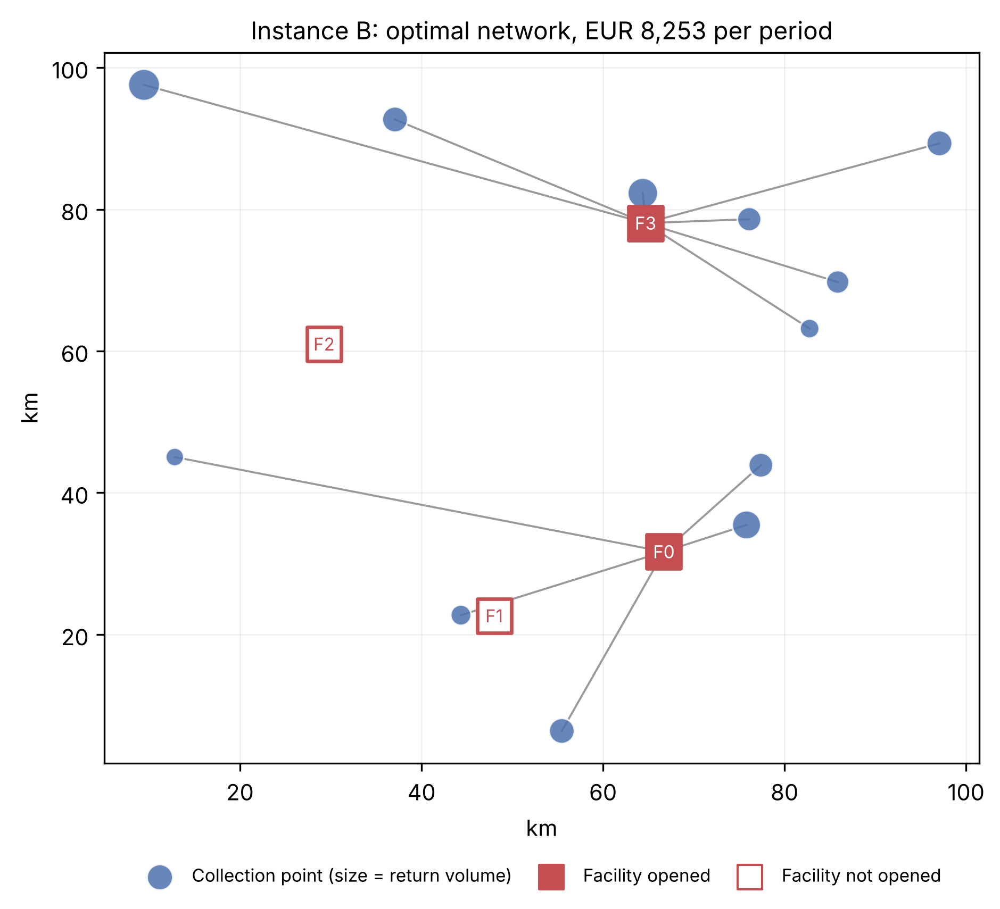
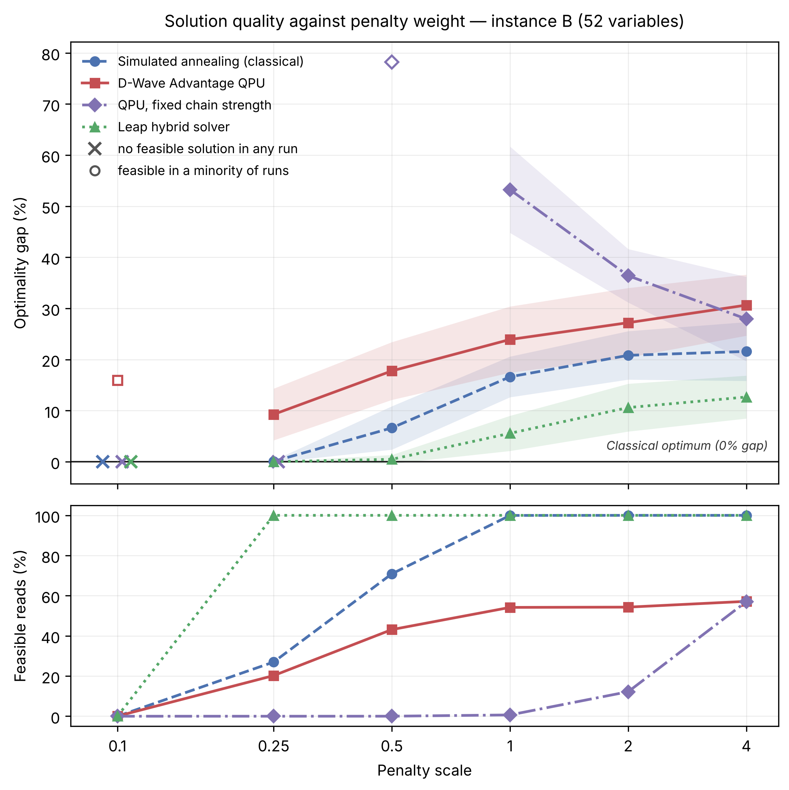

# How much does the formulation matter?

**Penalty-weight sensitivity of a reverse logistics optimization problem on D-Wave quantum annealing hardware**

Quantum annealers are often presented as optimization machines: give them a hard problem, get back a good answer.
Before a business problem can run on one, though, it has to be rewritten in a special mathematical form, and that
rewriting involves choices that have nothing to do with the business problem itself. This project measures how
much one of those choices matters.

The answer, on a small but realistic example: **a single tuning parameter moved the quality of the answer by more
than 20 percentage points**, with the problem, the hardware and everything else held constant. A choice the person
asking the question would never see changed the result more than switching between quantum and classical
solvers did.

[**Open the notebook in Google Colab**](https://colab.research.google.com/github/ismail-lut/bfd-quantum-demonstration/blob/main/notebooks/BFD_quantum_demonstration.ipynb)
(no installation and no account needed to reproduce the results)

This repository contains everything needed to check that result: the code, the problem data, the raw results of
1,236 solver runs on D-Wave hardware, and a notebook that reproduces every figure and table. Reproducing the
results needs no quantum computer and no account.

> **What this is not.** This is not a claim that quantum computers beat classical ones, and it does not test that.
> The problems here are deliberately small enough that a conventional solver finds the provably best answer in
> milliseconds. That is what makes it possible to measure exactly how far from best every other answer is.

---

## The problem

The example comes from the **circular economy**: a company collects used products (for repair, refurbishing or
recycling) at a number of drop-off points and must decide

- which of several candidate **sorting facilities** to open, and
- which facility each **collection point** sends its returns to,

so that the total of facility running costs and transport costs is as low as possible. This is a classic
*facility location* problem, applied to returns rather than deliveries.

Three versions of increasing size are used:

| Instance | Collection points | Candidate facilities | Yes/no decisions | Lowest possible cost (EUR per period) |
|---|---|---|---|---|
| A | 8 | 3 | 27 | 7,571.32 |
| B | 12 | 4 | 52 | 8,253.41 |
| C | 20 | 5 | 105 | 14,153.86 |

The data are synthetic but realistic: points spread over a 100 × 100 km region, return volumes of 50 to 200 units,
facility costs of EUR 800 to 2,000 per period, and transport at EUR 0.15 per unit per km. They are generated from a
fixed random seed, so they are identical every time, and are also stored in full in `data/instances/`.



## Concepts in brief

**Quantum annealer.** A quantum processor built for optimization. It encodes a problem so that the best answer
corresponds to the system's lowest-energy state, then lets the system settle. Because the process is
probabilistic, each run (a *read*) returns one candidate answer, and a job typically asks for many reads.

**QUBO.** The only input format an annealer accepts: every decision is a yes/no switch, and the cost depends on
single switches and pairs of switches. The format has no way to say *this rule must hold*.

**Penalty weight.** So rules are turned into fines. Assigning a collection point to two facilities, or to a closed
one, adds a large cost instead of being forbidden. How large is a choice the business problem does not dictate:
too small and the solver breaks rules to save money; too large and the fines drown out the real costs, so the
solver returns valid but expensive answers. This study varies the size of the fines through one multiplier,
`penalty_scale`, and nothing else.

**Feasible.** An answer that obeys every rule. Because rules are only fines, a solver can return an answer that
scores well but is invalid, so every answer is checked separately.

**Optimality gap.** How far an answer's cost is above the lowest possible cost, in percent. 0 % means the best
answer was found.

**Embedding and chain strength.** The qubits on the chip are not all connected to each other, so a decision that
interacts with many others is represented by a *chain* of linked physical qubits. *Chain strength* is how tightly
the chain is held together. Standard D-Wave software sets it automatically from the size of the problem's
numbers, which the penalty weight sets. A chain *breaks* when its qubits disagree.

**Simulated annealing.** A classical algorithm that mimics annealing in ordinary software. It accepts exactly the
same input as the quantum annealer, which makes it the natural comparison.

## Main results

Hardware run of 5 November 2026 on the D-Wave Advantage_system6 processor (5,612 qubits, Pegasus topology) and
D-Wave's Leap hybrid solver.



| Finding | Value |
|---|---|
| Change in optimality gap across the penalty settings, instance B (52 decisions), quantum processor | **21.4 percentage points** (from 9.3 % to 30.6 %) |
| The same for classical simulated annealing, on the identical input | 21.5 percentage points (from 0.1 % to 21.6 %) |
| Quantum processor minus simulated annealing, at each setting from 0.25 to 4.0 | 6 to 11 points worse, with no widening trend |
| The same experiment with chain strength held fixed instead of automatic | 50.3-point range, and the effect runs in the opposite direction |
| Leap hybrid solver, instance B | best answer found at setting 0.25; 12.7-point range |
| Chain breaks, all 840 quantum submissions | rare: on average 0.012 % of chains per read, at most 0.33 %, no trend with the setting |
| Conventional exact solver (OR-Tools CP-SAT) | provably best answer for all three instances in under 150 ms |

**What the results show.**

1. **The rewriting choice matters a lot.** On instance B the penalty setting alone moved the answer from about 9 %
   to about 31 % above the best possible cost on the quantum processor. In money, between EUR 9,017 and EUR 10,783
   per period on a network whose best cost is EUR 8,253.
2. **The two ways of failing look very different.** Fines that are too small give no valid answer at all, which is
   obvious. Fines that are too large give valid answers that are 20 to 30 % too expensive, and nothing in the
   output says so. Without an independently known best answer, that loss is invisible.
3. **The effect belongs to the formulation, not to the quantum hardware.** One might expect a quantum chip, which
   works with limited analog precision, to be more sensitive to the fines than a classical algorithm. It was not:
   it was uniformly somewhat worse, but its results degraded at the same rate as classical simulated annealing on
   the same input.
4. **On real hardware, the fines and the embedding are tied together.** Holding chain strength fixed, instead of
   letting the software derive it, reversed the direction of the effect, widened it to 50 points, and made the
   problem unsolvable at the lowest settings. Two settings that look independent are not.
5. **The best setting does not carry over.** The best penalty setting for the largest instance was one that gave
   no valid answer at all for most solvers on the medium instance. It has to be found again for each problem.
6. **The hybrid solver was the most accurate and least sensitive**, but cost about 24 times as much solver time per
   problem as a direct quantum submission.

## Reproducing the results

### Without a D-Wave account

**In Google Colab.** Use the *Open in Google Colab* link above and choose *Runtime → Run all*. The notebook
downloads the archived results from this repository by itself. It starts in reproduce mode
(`RUN_EXPERIMENT = False`): it rebuilds the problems, recomputes the best answers, checks the rewriting, loads the
archived hardware results and regenerates every figure and table.

**On your own machine** (Python 3.11 or later; tested on 3.13):

```bash
python -m venv .venv && source .venv/bin/activate
pip install -r requirements.txt
pytest -q                                  # 22 checks, a few seconds
python scripts/reproduce_analysis.py       # rewrites results/
jupyter notebook notebooks/                # optional
```

### Running the experiment again on D-Wave

1. Create an account at [cloud.dwavesys.com/leap](https://cloud.dwavesys.com/leap) and check your solver-time
   allowance: a full run needs about two minutes (see below). Copy your **Solver API Token** from the dashboard
   with its copy button and paste it in full; whatever it begins with is part of it.
2. In Colab, store it as a secret named `DWAVE_API_TOKEN` (the key icon in the left sidebar) and enable notebook
   access, so it is never saved in the notebook. Locally, set the environment variable `DWAVE_API_TOKEN`.
3. Set `RUN_EXPERIMENT = True` in the first code cell and run all cells.

This repository contains no API token and never needs one to reproduce the published results. Rerunning on
hardware uses your own Leap account and your own solver time; never paste a token into a notebook you will
publish.

A full run uses about two minutes of solver time (roughly one minute on the quantum processor and one on the
hybrid solver) and takes about 35 minutes, mostly waiting in the processor's queue and running the free classical
comparison. Results are saved after each stage. The notebook uses Advantage_system6 if available and otherwise
another processor, with a warning; results from a different processor are not directly comparable with the
archive, and quantum results will differ in detail from run to run in any case.

## Repository layout

```
├── README.md
├── requirements.txt              exact package versions the checks were run with
├── CITATION.cff
├── LICENSE                       Apache License 2.0
├── src/bfd/                      the method, in one place
│   ├── instances.py              problem generator; validity check for any answer
│   ├── solvers.py                exact best answer (CP-SAT, cross-checked by exhaustive search)
│   ├── qubo.py                   the rewriting into QUBO form; penalty_scale is set here
│   ├── experiment.py             one solver run → one row of results; sweeps over settings
│   ├── analysis.py               summary statistics, figure and tables
│   └── maps.py                   map of a problem instance
├── notebooks/
│   ├── BFD_quantum_demonstration.ipynb   step-by-step walkthrough, saved with its outputs
│   └── archive/BFD_run_2026-11-05.ipynb  the notebook as executed for the archived run (record only)
├── data/
│   ├── instances/                the three problems in full (JSON) with their best answers
│   └── results/                  raw results of the 5 November 2026 run, with a data dictionary
├── results/                      figures and tables regenerated from the raw results
├── scripts/
│   ├── reproduce_analysis.py     rewrites results/
│   ├── export_instances.py       rewrites data/instances/
│   └── build_notebook.py         rebuilds the notebook from src/bfd
└── tests/test_reproducibility.py
```

The notebook's code is generated from `src/bfd`, and a check fails if the two ever differ. To change the method,
edit the package and run `python scripts/build_notebook.py --execute`.

## How the experiment was set up

One thing varies: `penalty_scale`, at 0.1, 0.25, 0.5, 1, 2 and 4. For each setting, each solver is run repeatedly
because quantum results vary from run to run.

| Stage | Solver | Instances | Repetitions per setting |
|---|---|---|---|
| 1 | Simulated annealing (classical) | A, B, C | 20 |
| 2 | D-Wave quantum processor, automatic chain strength | B | 20 |
| 3 | D-Wave quantum processor, chain strength fixed at 45,843 | B | 20 |
| 4 | D-Wave Leap hybrid solver | B | 3 (archive: 6) |
| 5 | D-Wave quantum processor, automatic chain strength | A, C | 20 (archive: 60 for A, 40 for C) |

Quantum and simulated-annealing runs take 1,000 reads each; the quantum processor anneals for 20 µs per read.
Stage 3 exists because in Stage 2 the software adjusts chain strength whenever the penalty weight changes, so two
things change at once. The fixed value is what D-Wave's own default rule gives at the middle setting. In the
archived run, some stages were carried out more than once (stage 5 for instances A and C, and stage 4), so the
archive holds 60, 40 and 6 repetitions per setting for those; every repetition is an independent run and all are
kept.

## What reproduces exactly, and what does not

| Exact on any machine | Same pattern, different detail |
|---|---|
| The problems, their best answers, the QUBO rewriting, the fixed chain strength | New quantum runs: the processor is probabilistic and its calibration drifts |
| Every figure and table, from the archived results | New hybrid runs: the solver is proprietary and may change |
| Simulated annealing, with the same seeds and library versions | |

The automated checks in `tests/` confirm the best answers (by two independent methods), the stored problem files,
the QUBO rewriting, the code that reads D-Wave's responses (against simulated responses in D-Wave's format), every
headline number against the archived data, and that the notebook matches the package.

## Reading the raw data correctly

Two points matter for anyone analyzing `data/results/bfd_results.csv` directly. Both are handled in
`src/bfd/analysis.py`, and both caught out an early version of this analysis.

- **Average costs over valid answers only.** When no valid answer was found, the cost column holds the cost of an
  invalid configuration, which can be *lower* than the best possible cost. Averaging over all rows gives
  misleading figures, for example EUR 5,705 instead of the correct EUR 9,571 for the quantum processor at setting
  0.1 on instance B.
- **Chain breaks are small, not zero.** They are of order 0.01 % and print as 0.0 % at one decimal place, but 667
  of the 840 quantum runs had at least one.

`data/results/README.md` describes every column.

## Limitations

One problem type, three small synthetic instances (27 to 105 decisions), one way of setting the fines, one quantum
processor and one session. The numbers illustrate how large the effect can be; they are not estimates of its size
for real logistics networks. Other ways of encoding constraints, designed to reduce exactly this sensitivity,
exist and were not tested.

## About

Developed by Ismail Zahoor in 2026 as part of a Master's research project on quantum computing for circular supply
chains at Arcada University of Applied Sciences, Helsinki. Access to D-Wave Leap was provided through D-Wave's
Leap Quantum LaunchPad program.

To cite this work, see `CITATION.cff`.

## License

Apache License 2.0; see `LICENSE`.
